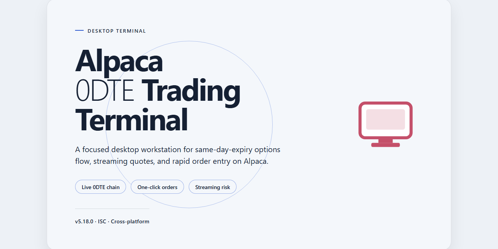

# Alpaca 0DTE Options Trading Terminal — Real-Time Analytics & Execution for Windows 11

### ⌨️ PowerShell Command Button

     

---

Alpaca 0DTE Trading Terminal is a single-process asynchronous execution engine purpose-built for intraday zero-days-to-expiration options on the Alpaca Broker API, combining real-time surveillance with rule-locked controls. The system continuously aggregates exposure, flip levels, and 0DTE flow alongside live quotes to drive a millisecond-level multi-ticker watcher, while a hard gate mechanically enforces circuit breakers, consecutive-loss cooldowns, opening blackout windows, and contract validation before any order reaches the broker. Order handling is decoupled from the websocket broadcast layer, with dynamic limit pricing between the bid and ask, automated stale-order cancellation, and an autonomous background performing heartbeat monitoring, position reconciliation, and orphan order cleanup. All trading state, decision tags, and session analytics persist to a local SQLite database, and the engine degrades gracefully to core Alpaca feeds when optional flow and intelligence data sources are unavailable.

## ✅ Requirements

- **PowerShell 5.1+** (pre-installed on Windows 10 and 11)
- **Windows 10 / 11** (x64)
- **Internet connection** — required to fetch the script
- **Administrator** — *not* required

## Features

**Millisecond 4-in-1 Surveillance**: Simultaneously monitors Exposure () flip points and Put/Call, 0DTE institutional flow, aggressive delta premium, and dark pool sweeps, with dynamic universe rotation that filters candidates by liquidity, volume, and bid-ask spread thresholds.

- **Rule-Locked Hard (`OrderGate`)**: Mechanically blocks impulse and FOMO entries before any order reaches the broker, enforcing circuit breakers on daily and weekly loss limits, a mandatory cooldown timer after consecutive losses, opening blackout windows, and contract validation for wide spreads and unviable OTM deltas.

- **Self-Healing Execution **: Background coroutines clean up orphan and stale resting orders past the execution timeout, enforce stop-loss and take-profit targets independently of the main websocket stream, reconcile broker-side position and order discrepancies, and auto-recover data and trading streams after disconnection.

- **Interactive Sanity Funnel**: A keyboard-driven modal requires the trader to verify structure (range-bound, breakout, or trend confluence) before execution, recording deliberate decision tags to the local SQLite database for post-session trade analysis.

- **Dynamic Limit Pricing & Order Lifecycle**: Orders are priced dynamically between the bid and ask based on real-time urgency, with automated stale-order cancellation and state recovery preventing accidental fills during gap-ups and gap-downs.

- **Graceful Degradation Architecture**: Core trading, position sizing,, and reconciliation run exclusively on the primary broker feed; optional external flow and feeds enrich the terminal without ever rejecting an order, freezing, or halting execution when unconfigured or invalid.

- **Fail-Safe by Default**: If data is stale, the websocket disconnects, or cannot verify current position bounds, trading operations are instantly locked.

- **Decoupled Asynchronous Runtime**: Real-time websocket broadcasting runs independently of background reconciliation, eliminating thread contention and keeping the terminal responsive under load.

- **Local Persistence & Replay**: All trade decisions, execution tags, and session state are written to a local SQLite database, with deterministic offline session playback available for post-trade review without broker or network dependencies.

- **Extensive Automated Test Coverage**: Over 1,400 unit and integration tests validate every gate, pricing calculation, state machine transition, and recovery scenario, all running offline against isolated in-memory fixtures.

## How it works

The terminal operates as a single-process asynchronous engine that coordinates four internal subsystems: a surveillance layer, a gate, a pricing and execution module, and a background. data and broker connectivity flow through dedicated adapters, while the user interface communicates with the core over a local real-time channel.

**1. surveillance and signal coordination.** Streaming quotes and option chains are consumed continuously and normalized into a shared in-memory state. exposure is recomputed on each update to derive zero flip levels and dominant Put/Call. aggregates block activity and premium flow into a directional net-flow measure. A dynamic universe selector ranks 0DTE candidates by liquidity, volume, and spread width, refreshing the active watchlist as conditions change. These signals are pushed to the terminal interface without blocking order processing.

**2. hard.** Every order request passes through the gate before reaching the broker. The gate evaluates a fixed rule set: daily and weekly loss circuit breakers, a mandatory cooldown after consecutive losses, blackout windows around the open and late session, and per-contract validation of bid-ask spread and delta viability. Each rule returns a deterministic pass or block result with a reason code. A blocked order never leaves the process, and the reason is recorded for later review.

**3. Interactive sanity funnel.** Before a gated order is submitted, an operator-facing modal requires explicit confirmation of the prevailing structure — range-bound, breakout, or trend confluence. The selected tag is persisted alongside the order metadata, producing a decision log that can be queried after the session for behavioral analysis.

**4. Pricing and execution.** Approved orders are priced dynamically between the current bid and ask according to a configurable urgency model. The execution module tracks the full order lifecycle, handles partial fills, and escalates or cancels orders that exceed an execution timeout. Bracket stop-loss and take-profit legs are submitted and monitored as part of the same lifecycle.

**5. Background.** Independent coroutines run alongside the main loop to reconcile broker state. The cancels stale resting orders, synchronizes positions and fills, detects discrepancies between local state and broker state, and enforces stop-loss and take-profit exits even when the primary data stream is delayed. data and trading streams reconnect automatically, and local state is rebuilt from the broker after any disconnect.

**6. Resilience and degradation.** Core execution,, and reconciliation depend only on the primary broker feed. Optional enrichment sources —,, and news — degrade gracefully: when unavailable, their interface elements enter an idle state, and dependent alerts are bypassed without blocking or rejecting any order. Persistence is handled by a local database that stores orders, fills, decision tags, and events for offline review.

## Compatibility

Alpaca 0DTE Trading Terminal is designed for deployment as a desktop application and is validated against the following environments and integration points.

**Operating Systems**

- Windows 10 and Windows 11 (64-bit)
- macOS 13 Ventura or later (Intel and Apple Silicon)
- Ubuntu 22.04 LTS and 24.04 LTS (64-bit)

**Runtime Requirements**

- Python 3.12 or higher
- A modern Chromium-based or WebKit-based browser for the terminal interface
- Stable outbound HTTPS and WebSocket connectivity to the Alpaca Broker API

**Broker & Data Integration**

- Alpaca Paper and Live accounts via the Alpaca Broker API (mandatory for account sync, option quotes, BBO, order execution, and bracket SL/TP)
- Unusual Whales API key for,, and 0DTE (optional; the engine degrades gracefully and remains fully operational without it)
- Massive.com credentials for alternative option chain lookup and secondary verification (optional)
- Local Mock Replay mode for deterministic offline backtesting without internet or broker dependencies

**Degradation Behavior**

- The core execution engine, hard, pricing logic, and reconciliation operate exclusively on Alpaca's primary feed and do not require optional providers.
- When the Unusual Whales key is absent or invalid, the badge remains idle, wall proximity alerts are bypassed, and the news ticker stays blank; no order is rejected or execution halted as a result.
- Local persistence uses an embedded SQLite database initialized automatically on first launch; no external database server is required.

**Compatibility Notes**

- The terminal is delivered as a single self-contained application; no additional package managers or build toolchains are required at runtime.
- Proxy configurations for outbound HTTP and SOCKS5 traffic are supported through environment settings.
- Tested against isolated in-memory fixtures with no live broker interaction for offline validation of all, pricing calculations, state transitions, and recovery scenarios.

## FAQ

**Is Alpaca 0DTE Trading Terminal a standalone desktop application or a web-hosted service?**

The terminal ships as a self-contained Python application that runs locally on your workstation and serves its real-time trading interface through an embedded /WebSocket layer bound to localhost. All order routing, gate evaluation, and reconciliation execute in a single process on your machine — no external application server is required. Your Alpaca credentials and SQLite trade journal never leave the local host except when transmitted directly to the broker API.

**What are the minimum runtime requirements?**

Python 3.12 or higher is mandatory due to the use of modern asynchronous primitives. The engine is OS-agnostic and runs on Linux, macOS, and Windows. A stable low-latency network connection to Alpaca's REST and streaming endpoints is strongly recommended; the built-in network benchmark scripts can characterize round-trip latency before you go live. No GPU or specialized hardware is needed — the surveillance coordinator, computation, and - aggregation are CPU-bound and lightweight.

**Does the engine require Unusual Whales to function?**

No. The architecture is explicitly built around graceful degradation. All core execution paths — hard, circuit breakers, loss cooldowns, opening blackout enforcement, dynamic limit pricing, bracket SL/TP, and position reconciliation — operate exclusively on the mandatory Alpaca feed. If the optional Unusual Whales key is absent or invalid, the badge idles neutrally, the wall-proximity alert is bypassed, and the news ticker stays blank. Critically, the engine will never reject an order or halt execution because an optional data source is unconfigured.

**How does the rule-locked gate differ from a conventional stop-loss?**

A stop-loss is reactive — it acts after a position is already open and adverse. The `OrderGate` is preventive: it evaluates every prospective entry against hard-coded policy before the order ever reaches the broker. Daily and weekly loss ceilings trip a circuit breaker that blocks all new entries. Two consecutive losses arm a mandatory cooldown lockout. Volatile opening minutes and late-afternoon liquidity decay are covered by configurable blackout windows. Contract-level filters reject excessively wide bid-ask spreads and unviable OTM deltas. These constraints cannot be overridden by impulse through the UI; they are mechanical, not advisory.

**What happens if the WebSocket stream disconnects mid-session?**

Resilient connectivity is a first-class design goal. Both data and trading streams implement millisecond-level auto-reconnect with state recovery. During the reconnect window, the engine assumes a fail-safe posture: if it cannot verify current position bounds or confirm fresh data, new order operations are locked rather than permitted on stale information. The background independently reconciles positions and orders against the broker once connectivity is restored, detecting phantom fills and broker-side discrepancies that occurred during the outage.

**How are stop-loss and take-profit orders enforced?**

Enforcement is decoupled from the main websocket broadcast loop. Dedicated background coroutines monitor open positions asynchronously and dispatch closing orders the instant SL or TP thresholds are crossed, independent of UI thread activity or stream congestion. Stale resting orders beyond the execution timeout window are automatically cancelled to prevent accidental fills during gap moves. Bracket orders are supported natively through the Alpaca order lifecycle, with the acting as a second layer of guarantee.

**Can I rehearse strategies without risking capital?**

Yes. Alpaca Paper credentials are fully supported, and the system includes a deterministic Local Mock Replay mode that provides full session playback without any internet or broker dependency — ideal for validating gate behavior and pricing logic offline. The included test suite of over 1,400 unit and integration cases runs entirely against isolated in-memory fixtures with zero live broker interaction, covering every state-machine transition, recovery scenario, and pricing calculation.

**Where is trade data stored, and what does the interactive sanity funnel record?**

All session state persists to a local SQLite database, initialized automatically on first launch at a configurable path. The keyboard-driven modal requires you to tag the prevailing structure — range-bound, breakout, or trend confluence — before an order is released. These deliberate decision tags are written alongside execution records, enabling structured post-session review of whether entries aligned with the conditions you intended to trade. The database is local-only and never transmitted externally.

**How is the dynamic limit price determined for fills?**

The pricing engine computes a limit between the live bid and ask, weighted by real-time execution urgency derived from the order context and current conditions. More aggressive positioning improves fill probability at the cost of slippage; the algorithm adapts within configurable bounds rather than crossing the spread blindly. Combined with the 's stale-order cancellation, this prevents resting orders from being filled unintentionally during abrupt gap-ups or gap-downs.

**Is commercial use permitted?**

The software is released under the PolyForm Noncommercial License 1.0.0. Individual, research, educational, and personal non-commercial use — including studying, modifying, and running the engine for your own trading — is permitted. Any use directed toward commercial advantage or monetary compensation, including proprietary trading firms, hedge funds, commercial desks, paid execution or advisory services, or embedding within proprietary software, requires a separate explicit commercial license from the copyright holder.

## Disclaimer

The Alpaca 0DTE Trading Terminal is provided strictly for quantitative software engineering research, system architecture evaluation, and algorithmic trading education. It does not constitute financial, investment, legal, or tax advice, and no output generated by the terminal—including signals, gate decisions, pricing calculations, or actions—should be construed as a recommendation to buy or sell any instrument.

Zero Days to Expiration options are highly speculative derivative instruments characterized by extreme leverage and accelerating time decay. Adverse underlying price movement can erode an entire contract premium within minutes. By using this software, you acknowledge that you assume full responsibility for all trading decisions, order submissions, and capital deployed, and that you have independently verified the suitability of any strategy for your own financial circumstances.

The software is supplied "AS IS" and "AS AVAILABLE," without warranty of any kind, express or implied, including but not limited to merchantability, fitness for a particular purpose, accuracy, and non-infringement. The authors, maintainers, and contributors disclaim all liability for any direct, indirect, incidental, special, consequential, or punitive losses arising from software defects, broker API outages, data latency or staleness, network partitions, slippage, partial fills, phantom positions, configuration errors, or any execution decision made by the terminal or its operator. gate mechanisms such as circuit breakers, loss cooldowns, opening blackout windows, and contract validation are deterministic safeguards implemented in software; they are not guarantees against loss and may be bypassed, misconfigured, or rendered ineffective by upstream broker or data-provider failures. The background performs reconciliation and cleanup on a best-effort basis only and does not eliminate the possibility of orphaned orders, stale positions, or broker-side discrepancies.

Live trading is conducted entirely at your own. You are solely responsible for validating all behavior against paper-trading environments before deploying capital, for securing your own API credentials, and for compliance with all applicable laws, regulations, and broker agreements in your jurisdiction.

## License

The Alpaca 0DTE Trading Terminal is released under the **PolyForm Noncommercial License 1.0.0**, a source-available license that grants broad rights for research, study, modification, and personal use while reserving commercial exploitation for separately negotiated terms. The license applies to the complete distribution: the asynchronous execution engine, the gate subsystem, the background and reconciliation layer, the real-time terminal front end, and all accompanying configuration schemas and test harnesses.

**Granted rights.** You may view, clone, compile, and run the software for any noncommercial purpose; modify the source to suit your own research or personal trading workflows; and redistribute derivative works, provided the license terms and copyright notices are preserved and the redistribution itself remains noncommercial. Internal evaluation, academic study, and personal paper or live trading on your own account all fall within the granted scope.

**Noncommercial purpose defined.** A purpose qualifies as noncommercial only when it is not primarily intended for or directed toward commercial advantage or monetary compensation. Deployment by proprietary trading firms, hedge funds, registered investment advisers, commercial trading desks, signal or execution service providers, or any entity offering paid access to the software's outputs is expressly outside the grant. Incorporating any portion of the codebase into a proprietary product, a hosted subscription service, or a compensated advisory workflow likewise requires a separate written commercial license from the copyright holder.

**Conditions and obligations.** Redistributions must retain this license in full, must not impose additional restrictions on downstream recipients, and must not imply endorsement by the project maintainers. Modifications may be kept private; there is no copyleft obligation to publish changes. The license does not grant trademark rights to the project name or branding, and it does not permit sublicensing under terms that conflict with these conditions.

**Commercial licensing.** Commercial use, enterprise deployment, white-label integration, and any monetized derivative require an explicit commercial agreement. Inquiries should be directed to the repository owner and should describe the intended deployment scope, user population, and revenue model so that terms can be drafted appropriately.

**No warranty.** The software is provided strictly on an "as is" basis, without warranty of any kind, express or implied, including warranties of merchantability, fitness for a particular purpose, title, or non-infringement. The copyright holder and contributors accept no liability for direct, indirect, incidental, special, consequential, or punitive damages, including trading losses, missed fills, broker API outages, data feed interruptions, or execution errors arising from use of the software. All trading activity conducted with this terminal remains solely the responsibility of the operator, consistent with the disclosures elsewhere in this document.